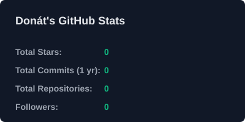

### Hi there, I'm Donát 👋

I specialize in mobile and frontend web development, focusing on clean architecture and smooth user experiences.

- 🎓 I'm doing my Master's in Computer Science Engineering at Budapest University of Technology and Economics
- 💻 Working as a Frontend Developer
- **How to reach me:**
  -  [kovacsdonat@edu.bme.hu](mailto:kovacsdonat@edu.bme.hu)
  -  [LinkedIn](https://www.linkedin.com/in/kovacsdonat)

---

### Tech Stack

**Languages**

  

**Frontend & Mobile**

  

**Backend & Databases**

  

**Infrastructure & Tooling**

  

---

### 📊 GitHub Analytics
